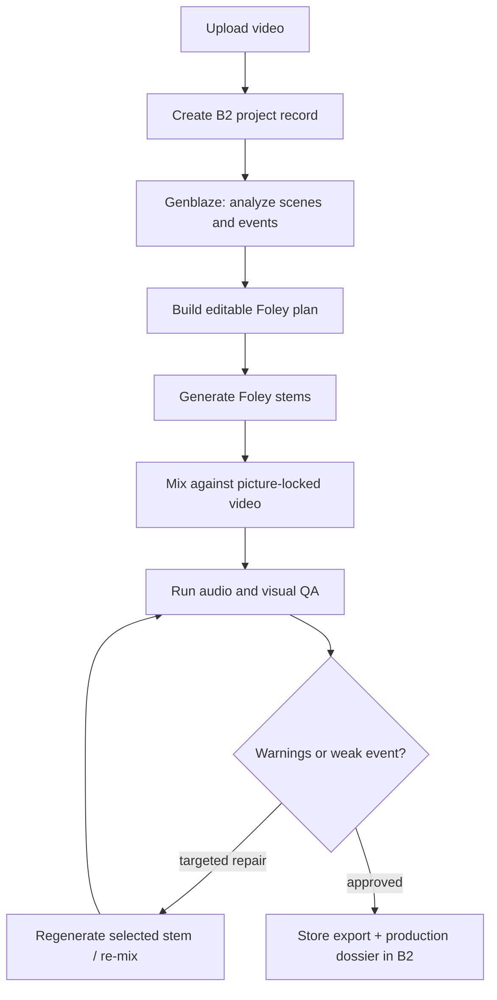

# FoleyFlow

> **An AI post-production copilot that turns a rough video into an auditable, production-ready deliverable.**

**Hackathon:** Backblaze Generative AI Media Hackathon  
**Status:** Build specification / MVP scope  
**Primary requirement:** Backblaze B2 + Genblaze used as first-class parts of the workflow.

---

## 1. Product summary

FoleyFlow analyzes a video, generates and mixes synchronized Foley, runs technical post-production checks, and preserves the full production record.

It is not another one-shot sound-effect generator. It is a **post-production control room**: a creator sees what is ready, what needs attention, why it was flagged, and can apply a targeted repair without re-running the entire job.

Foley is the headline feature. The complementary checks—scene detection, audio clipping/loudness, and visual continuity warnings—prove that FoleyFlow is a production workflow rather than a single media-generation demo.

### One-line pitch

> FoleyFlow is an AI post-production copilot that analyzes, enhances, quality-checks, and preserves every decision behind a finished video.

---

## 2. Problem

AI-generated and low-budget video commonly reaches picture lock with incomplete or inconsistent post-production:

- footage is silent or has poor sound design;
- effects do not line up with visible actions;
- shots have inconsistent exposure or color;
- audio clips or misses delivery loudness targets;
- files and the reasoning behind revisions are scattered across tools;
- a fix to one detail often means rebuilding too much of the project.

Professional teams solve this through separate departments and careful versioning. Solo creators and small studios need a focused workflow that makes the next repair obvious, limits recomputation, and retains a reliable production history.

---

## 3. Users and jobs to be done

### Primary users

- AI-video creators publishing short films, ads, or social video
- Indie filmmakers and small post-production teams
- Animation and game teams preparing trailers or cutscenes

### Core job

"I have a mostly finished video. Help me identify the highest-value post-production issues, generate the missing sound design, make targeted improvements, and retain a defensible final package."

---

## 4. Product principles

1. **Foley is the hero.** The primary reveal is silent video becoming convincingly sound-designed.
2. **Diagnose before generating.** Every generation is tied to a scene, event, recommendation, and recorded decision.
3. **Repair only what changed.** A weak footstep should regenerate one stem, not restart the production.
4. **Human stays in control.** Users can accept, ignore, lock, or re-run recommendations.
5. **B2 is the production system of record.** Assets, versions, checks, logs, and provenance live in durable project storage—not merely the final export.
6. **Honest automation.** A step is called an agent only when it evaluates evidence and chooses an action or escalation. Deterministic analyses are labelled checks.

---

## 5. MVP scope

### In scope

| Capability | MVP behavior | User value |
|---|---|---|
| Project intake | Upload a short video (target: 5–30 seconds). Create B2 project namespace and immutable input record. | Starts a traceable production job. |
| Scene analysis | Detect scene boundaries and construct a compact scene summary. | Makes issues and generated assets navigable. |
| Foley plan | Produce an editable event timeline: ambience plus 2–5 high-confidence discrete sounds. | Gives the user a clear sound-design plan. |
| Foley generation | Generate routed sound-effect stems and sync them to picture lock. | Creates the memorable before/after result. |
| Mix QA | Measure true peak/clipping and integrated loudness; flag failing scenes or final mix. | Makes the output technically safer. |
| Visual continuity QA | Detect simple exposure/color discontinuities between adjacent shots; report as warnings, not automatic corrections. | Demonstrates multimodal post-production analysis without expanding into color grading. |
| Targeted repair | Regenerate a selected Foley event or re-render the mix while retaining the original timeline/version. | Shows efficient iteration. |
| Production dossier | Browse/download manifest, timeline versions, checks, prompts, stems, final mix, and final MP4 from B2. | Supplies reproducibility and a clear B2 story. |

### Explicitly out of scope for the hackathon MVP

- Automatic color grading or LUT application
- Dialogue separation, transcription, or voice restoration
- Full DAW editing and multitrack waveform UI
- Long-form videos, batch processing, or multi-user collaboration
- Autonomous artistic approval without a human review step
- More than one purposeful repair loop in the live demo

These are roadmap modules, not promised MVP behavior.

---

## 6. User experience

### 6.1 Main screen: Post-production readiness

The project page is a single control room rather than separate AI tools. It includes a video preview, readiness score, scene rail, and a checklist of completed, warning, and actionable stages.

```text
POST-PRODUCTION READINESS                                  82% ready

✓ Scene analysis complete              4 scenes detected
✓ Foley plan approved                  6 events / 2 ambience layers
✓ Foley stems synchronized             6 generated assets
⚠ Scene 3: exposure differs from Scene 2
⚠ Final mix: true peak exceeds target by 1.4 dB
✓ Production dossier stored in B2      18 artifacts / signed manifest

                    [Review warnings] [Render final]
```

### 6.2 Primary flow

1. The creator creates a project and uploads a video.
2. FoleyFlow creates a B2-backed project workspace and runs the analysis workflow.
3. The UI displays a scene-aware checklist and Foley event timeline.
4. The creator previews **original** versus **Foley mix**.
5. The creator opens a warning or weak Foley event, then selects **Regenerate this event**.
6. The workflow creates a new stem and mix version, re-runs QA, and records the lineage.
7. The creator exports the final MP4 and opens the production dossier.

### 6.3 Information hierarchy

- **Ready:** completed checks and generated assets
- **Needs review:** non-blocking visual continuity warnings
- **Needs repair:** audio clipping or a rejected/weak Foley asset
- **History:** prior mixes, prompts, model/provider versions, and QA results

No warning should masquerade as an automated fix. A continuity warning opens an explanation, confidence, and the two scene thumbnails it compared.

---

## 7. End-to-end workflow



### Workflow stages

| Stage | Kind | Output |
|---|---|---|
| Ingest | deterministic | Input metadata, checksum, B2 object URL/key |
| Scene analysis | AI-assisted | Scene boundaries and semantic summaries |
| Foley planner | AI-assisted | Event timeline and generation prompts |
| Stem generator | provider task | Canonical WAV stems plus generation metadata |
| Mix | deterministic | Picture-locked WAV and MP4 |
| QA | deterministic + AI-assisted | Loudness/peak metrics, visual-continuity warnings, recommended action |
| Repair router | agentic decision | A narrowly scoped regeneration or a user-review request |
| Archive | deterministic | Versioned manifest, provenance, signed final record |

---

## 8. Architecture

### 8.1 Proposed implementation

Use the existing Python Foley pipeline as the media core. Add a thin web application API and workflow/storage adapters around it. Do not rebuild the proven audio pipeline in a new Go/Svelte stack during the hackathon.

```text
Web client
  └─ Project dashboard: readiness checklist, player, scene/event timeline,
     targeted regeneration, artifact/provenance browser

Python API service
  ├─ Project and job API
  ├─ Signed B2 upload/download URL service
  ├─ Genblaze workflow launcher and status adapter
  └─ Existing Foley analyzer, router, assembler, and muxer

Genblaze workflow
  ├─ Scene/event analysis
  ├─ Provider-backed Foley generation
  ├─ QA + retry decision
  └─ Artifact/provenance publication

Backblaze B2
  └─ Canonical assets, manifests, thumbnails, logs, and version history
```

### 8.2 Genblaze responsibilities

Genblaze must visibly orchestrate the workflow—not simply appear as an installed dependency.

- define the ordered stages and their inputs/outputs;
- invoke configured media providers for generation and analysis;
- record execution state, timing, errors, and retries;
- fan out independent sound-effect generation where safe;
- retry only the failed or low-confidence stem;
- publish stage artifacts and provenance to B2.

The app should show the workflow run ID, current stage, and stage-level outcome in its job history.

### 8.3 Backblaze B2 responsibilities

B2 is FoleyFlow's canonical project archive:

- direct video upload destination through presigned URLs;
- original input and immutable content checksum;
- scene thumbnails and analysis JSON;
- prompts, provider responses, WAV stems, mixes, and final MP4s;
- QA reports and workflow logs;
- versioned provenance manifest for every export;
- short-lived signed links for preview and download.

### 8.4 Mosaic relationship and future integration

FoleyFlow adopts Mosaic's core product principles: immutable history, schema-validated AI outputs, deterministic state transitions, explicit human approval for consequential actions, and an evidence-first UI. It is **not** coupled to Mosaic's current incident-operations reference application for the hackathon MVP.

Mosaic's current API, projector, ontology, and reference UI are purpose-built for its emergency-operations domain. Its documented generic `DomainProfile` seam is a future integration route, rather than an implementation dependency that FoleyFlow should rush into during the hackathon.

#### MVP decision

FoleyFlow ships as a standalone post-production application:

- its Python worker owns Genblaze workflows, provider adapters, media processing, and B2 artifact publication;
- its focused UI owns the readiness checklist, A/B player, timeline, repair approval, and production dossier;
- its project/run state is designed as immutable, versioned records using the same safety and audit principles as Mosaic;
- its API may use a simple project/job store appropriate to the deployed MVP, without importing Mosaic's incident-domain schemas or projector.

This preserves a clear judge-facing story and avoids turning a media-workflow submission into a refactor of an unrelated reference domain.

#### Post-hackathon integration path

When Mosaic's generic profile contract is implemented, FoleyFlow can become a first external domain profile. Mosaic would provide the control-plane responsibilities—project/run state, human approvals, audit history, and streamed lifecycle notifications—while FoleyFlow remains the media execution worker and B2 remains the canonical artifact archive.

```text
Mosaic control plane
  └─ immutable project/run/approval/audit records and SSE lifecycle updates

FoleyFlow Python worker
  └─ Genblaze, GMI, SFX providers, ffmpeg, QA, and B2 artifact publication

FoleyFlow workspace
  └─ post-production checklist, A/B preview, timeline, and production dossier
```

The future contract must use domain-neutral lifecycle records rather than inherit incident terms. Initial event types are:

```text
postproduction.project.created
postproduction.analysis.completed
postproduction.foley.plan.proposed
postproduction.repair.approved
postproduction.stem.generated
postproduction.qa.flagged
postproduction.export.approved
```

Every approval event identifies the actor, selected asset/run version, estimated cost when billable, and resulting artifact lineage. AI-generated results are proposals or evidence; they do not silently approve a spend or publish a final export.
---

## 9. Cost-aware SFX routing

FoleyFlow selects sound-generation providers according to the role of the sound, the available budget, and the need for precise repair. This is a visible, user-controllable production decision—not hidden routing logic.

### 9.1 Default routing policy

| Sound role | Default provider/model | Why it is selected | Indicative unit cost |
|---|---|---|---|
| Long ambience bed: rain, wind, room tone, traffic | CassetteAI Sound Effects Generator | Inexpensive prompt-to-SFX generation with outputs up to 30 seconds; ideal for one continuous, loopable bed. | $0.01 per generation |
| Hero discrete Foley: footsteps, armor, doors, impacts, props | ElevenLabs Sound Effects | Use for the small number of sounds a viewer will notice most, where quality and distinctiveness matter. | $0.12 per generated minute (about $0.02 for 10 seconds) |
| Fast full-scene soundscape preview | MMAudio V2 | Video-conditioned draft audio can provide quick coverage and a useful comparison layer, but is not the canonical editable Foley stem path. | $0.001 per second (about $0.015 for 15 seconds) |
| Alternative SFX candidate / A-B evaluation | Stable Audio 3 Small SFX | Optional provider for testing an alternate texture before a human selects a take. | $0.0206 per audio generation |

Prices are planning estimates, not price guarantees. Before submission and in any deployment, FoleyFlow reads the current provider pricing/configuration and records the estimate actually presented to the user.

### 9.2 Why routing matters

The project should not create a separate expensive generation for every sound by default. A 15-second clip can usually be covered by one ambience generation plus a handful of event-level effects:

```text
Rain ambience (CassetteAI)                $0.01
Armor footsteps (ElevenLabs SFX)          $0.02 estimate
Door / prop impact (ElevenLabs SFX)       $0.02 estimate
Optional MMAudio full-scene draft         $0.015 estimate
                                              -------
Illustrative reviewed mix total            $0.05–$0.07
```

The estimate must be shown before billable regeneration. A user should be able to lock an approved stem, choose a lower-cost provider, or explicitly approve a higher-quality retry.

### 9.3 Repair and escalation policy

1. Generate one low-cost ambience bed and cache it by prompt, duration, model, and parameters.
2. Generate individual high-salience Foley events as independent stems.
3. If a stem fails technically, retry the same provider once automatically.
4. If a stem is judged weak by QA or the user, offer the estimated cost and let the user choose: regenerate with the same provider, try an approved alternative, or retain the current take.
5. Re-mix only the selected approved stems; never regenerate picture or unaffected sounds.

MMAudio output is explicitly labelled **"draft scene soundscape"**. It may be played as an A/B reference, but it does not replace the independently versioned stems required for targeted edits and provenance.

### 9.4 User-facing cost and provenance

The project dashboard includes a compact production-cost panel:

```text
Generation budget: $0.07 estimated / $0.05 spent
✓ Rain ambience — CassetteAI — $0.01
✓ Armor footsteps v1 — ElevenLabs SFX — $0.02
⚠ Regenerate door creak — ElevenLabs SFX — estimated $0.02
```

Every generated asset records the provider, model, requested duration, pricing estimate shown at approval, incurred cost when available, and the routing rationale. These fields are included in the B2-backed provenance manifest so costs and quality decisions remain auditable.

---

## 10. B2 object layout

Use a project UUID and immutable run/version IDs. Never overwrite a completed generation or manifest.

```text
foleyflow/projects/{project_id}/
  input/
    source.mp4
    source.metadata.json
  scenes/{scene_id}/
    thumbnail.jpg
    analysis.json
  timelines/
    timeline.v1.json
    timeline.v2.json
  runs/{run_id}/
    workflow.json
    logs.jsonl
    qa-report.json
    prompts/{event_id}.json
    stems/{event_id}.wav
    mixes/mix.v1.wav
    exports/final.v1.mp4
    provenance.manifest.json
  exports/
    latest.json
```

`exports/latest.json` is the only mutable pointer. It names an immutable final run and allows the UI to find the current approved export without losing history.

---

## 11. Data contracts

### 10.1 Project

```json
{
  "id": "proj_01J...",
  "title": "Rainy courtyard",
  "status": "needs_review",
  "input_key": "foleyflow/projects/proj_01J.../input/source.mp4",
  "created_at": "2026-07-25T12:00:00Z",
  "latest_run_id": "run_01J..."
}
```

### 10.2 Timeline event

```json
{
  "id": "evt_armor_steps_01",
  "scene_id": "scene_02",
  "name": "heavy armor footsteps on wet stone",
  "kind": "rhythmic",
  "start_s": 3.2,
  "end_s": 5.7,
  "intensity": "medium",
  "prompt": "heavy armored boots walking on rain-soaked cobblestone, close and weighty",
  "status": "approved",
  "stem_version": 2
}
```

### 10.3 QA report

```json
{
  "run_id": "run_01J...",
  "overall_status": "needs_review",
  "audio": {
    "integrated_lufs": -13.2,
    "true_peak_dbtp": 1.4,
    "target_lufs": -14,
    "target_true_peak_dbtp": -1.0,
    "issues": [
      {"severity": "blocking", "scene_id": "scene_05", "code": "true_peak_exceeded"}
    ]
  },
  "visual": {
    "issues": [
      {
        "severity": "warning",
        "scene_id": "scene_03",
        "code": "exposure_discontinuity",
        "confidence": 0.82,
        "compared_with": "scene_02"
      }
    ]
  }
}
```

### 10.4 Provenance manifest

The final manifest contains a complete, hashed inventory of each artifact and the lineage necessary to reproduce or audit it.

```json
{
  "manifest_version": "1.0",
  "project_id": "proj_01J...",
  "run_id": "run_01J...",
  "created_at": "2026-07-25T12:15:00Z",
  "workflow": {"engine": "genblaze", "workflow_id": "...", "version": "..."},
  "source": {"b2_key": ".../source.mp4", "sha256": "..."},
  "artifacts": [
    {
      "type": "audio_stem",
      "event_id": "evt_armor_steps_01",
      "b2_key": ".../stems/evt_armor_steps_01.wav",
      "sha256": "...",
      "provider": "...",
      "model": "...",
      "prompt": "...",
      "parameters": {},
      "retry_of": "run_01J.../stems/evt_armor_steps_01.v1.wav"
    }
  ],
  "qa_report_key": ".../qa-report.json",
  "final_export_key": ".../exports/final.v1.mp4"
}
```

---

## 12. AI/provider strategy

Use the fewest providers needed for an impressive and repeatable demo. All names must be replaced with the actual configured provider/model IDs before submission.

| Need | Example implementation | Constraint |
|---|---|---|
| Video/scene understanding | Multimodal model via Genblaze-supported provider | Output schema-validated scene/event JSON |
| Foley sound effects | Cost-aware routed SFX providers via a Genblaze task | Generate ambience and discrete events independently; cache by content hash |
| Visual continuity | Deterministic frame statistics first; optional multimodal explanation | Warning only; do not claim automatic color correction |
| Audio QA | ffmpeg/EBU R128 measurement and true-peak analysis | Deterministic, stored as raw metrics |
| Mix/mux | Existing local picture-lock renderer | Preserve source video stream unchanged |

Provider failures should result in a clear `needs_review` or retry state, never a silently incomplete "complete" project.

---

## 13. Readiness scoring and repair policy

The score is a transparent convenience, not a black-box quality claim.

| Condition | Effect |
|---|---|
| Scene analysis absent | Block final export |
| No approved Foley plan | Block final export |
| Required stem failed | Block final export |
| True peak above target | Block final export until limiting/re-mix is applied or user overrides |
| Loudness outside target range | Warning; user can normalize/re-mix |
| Exposure/color discontinuity | Warning; opens comparison evidence |
| All required artifacts and manifest in B2 | Enables final approval/export |

The repair router may automatically retry a provider/network failure once. Artistic or continuity assessments require user confirmation before a new generation is billed.

---

## 14. API surface (MVP)

| Method | Endpoint | Purpose |
|---|---|---|
| `POST` | `/projects` | Create project and B2 upload session |
| `POST` | `/projects/{id}/analyze` | Start Genblaze analysis workflow |
| `GET` | `/projects/{id}` | Fetch project, readiness, and current run |
| `GET` | `/projects/{id}/timeline` | Fetch editable timeline |
| `POST` | `/projects/{id}/events/{event_id}/regenerate` | Start targeted stem regeneration |
| `POST` | `/projects/{id}/mixes` | Re-mix from selected approved stems |
| `GET` | `/projects/{id}/qa` | Fetch the latest QA report |
| `POST` | `/projects/{id}/exports` | Store final export and provenance manifest |
| `GET` | `/projects/{id}/dossier` | Enumerate B2-backed artifacts and signed links |

All mutation responses return a job/run ID so the UI can show stage-level Genblaze status rather than pretending work completed synchronously.

---

## 15. Demo plan (about 3 minutes)

**Clip:** 10–15 second silent rainy-courtyard or western-standoff footage with clear footsteps and environmental sound.

1. **0:00–0:20 — Problem:** Play the silent source. Introduce it as a picture-locked clip that is visually finished but not post-production ready.
2. **0:20–0:55 — Analyze:** Upload/enter the project. Show Genblaze workflow stages and B2 project creation. Scene analysis finds the rain, walking, and environmental context.
3. **0:55–1:30 — Foley reveal:** Show the editable plan, event timeline, and instant silent-versus-mixed A/B toggle. Play the generated rain, armor/boot steps, wind, and thunder.
4. **1:30–2:05 — QA:** Open the readiness checklist. Show a flagged overly hot mix and a visual exposure mismatch between two shots. Clarify that the latter is a review warning, not an invented automatic correction.
5. **2:05–2:35 — Targeted repair:** Regenerate one weak footstep stem or re-mix to fix the peak. Show that only one asset changes and QA updates.
6. **2:35–3:00 — B2 proof:** Open the dossier: original video, timeline versions, stem v1/v2, mix, report, workflow log, and hash-backed provenance manifest. Export the final MP4.

The demo must use the real deployed app, a real B2-backed project, and a real Genblaze workflow run. Pre-seeded media is acceptable; fake state or hand-written "live" logs are not.

---

## 16. Submission requirements checklist

- [ ] Public working app URL that a judge can open without local dependencies
- [ ] Public GitHub repository with setup, environment variables, and local run instructions
- [ ] Exact providers and model IDs listed in the README
- [ ] Clear B2 explanation: object layout, signed upload/download, artifact retention, manifests
- [ ] Clear Genblaze explanation: workflow definition, provider tasks, stage status, retry behavior
- [ ] 3-minute demo video showing an actual workflow, targeted repair, B2 dossier, and final export
- [ ] Explicit limitations and roadmap, especially for visual continuity checks

---

## 17. Delivery plan

### Milestone 1 — Foundation

- Create project API and minimal dashboard shell.
- Provision B2 bucket/prefix configuration and direct upload path.
- Define project/run/manifest schemas.
- Adapt existing Foley pipeline into callable job stages.

**Exit condition:** an uploaded video is stored in B2 and can be listed as a project.

### Milestone 2 — Core Foley workflow

- Implement Genblaze workflow for analysis, planning, routed stem generation, mix, and B2 publication.
- Display live run status and produce a timeline plus final MP4.
- Store all artifacts under the defined B2 layout.

**Exit condition:** a short clip can complete silent-video to B2-backed Foley export.

### Milestone 3 — QA and targeted repair

- Add loudness/peak metrics and visual continuity warning.
- Add per-event regenerate action and versioned re-mix.
- Publish a final provenance manifest with hashes and lineage.

**Exit condition:** one selected stem is regenerated without redoing the full project, and its version lineage is visible.

### Milestone 4 — Judge-ready polish

- Build the readiness/checklist UI and artifact dossier.
- Deploy a reliable demo environment and seed a showcase project.
- Rehearse the 3-minute script against the deployed app.
- Document provider/model, B2, and Genblaze usage precisely.

**Exit condition:** a judge can reproduce the key flow from the app and repository instructions.

---

## 18. Success criteria

FoleyFlow is ready to submit when a judge can verify all of the following:

1. A real video enters a B2-backed project.
2. Genblaze orchestrates visible, meaningful workflow stages.
3. The app produces an audible, synchronized Foley transformation.
4. The app surfaces at least one useful technical or visual QA finding.
5. A targeted repair updates only the relevant asset/mix version.
6. The final export can be traced to its source, prompts, models, QA results, and B2 objects through a provenance manifest.

---

## 19. Future roadmap

After the hackathon, FoleyFlow can expand into dedicated modules:

- dialogue cleanup and transcription confidence checks;
- assisted color matching with user-approved grade suggestions;
- caption/accessibility analysis;
- multi-clip campaign consistency checks;
- collaborative review/approval states;
- searchable B2 media library and semantic asset reuse;
- policy-aware rights, model, and licensing metadata.

The architectural boundary remains the same: each module contributes versioned evidence and artifacts to a single durable post-production record.
