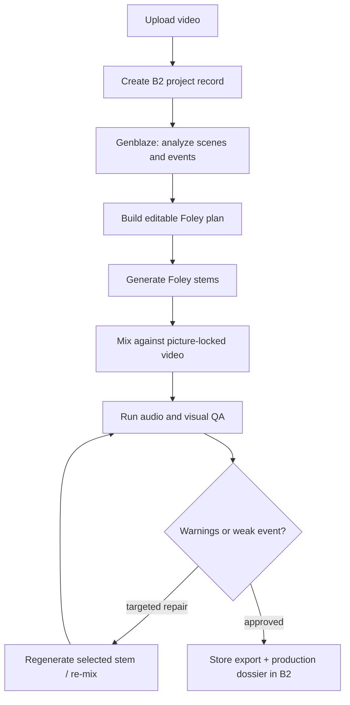

# FoleyFlow

> **An AI post-production copilot that turns a rough video into an auditable, production-ready deliverable.**

**Hackathon:** Backblaze Generative AI Media Hackathon (submission 3 August 2026)  
**Status:** Partially built — see §0.  
**Primary requirement:** Backblaze B2 + Genblaze used as first-class parts of the workflow.

---

## 0. Implementation status

Kept at the top because the rest of this document describes the intended
product, and a reader needs to know which parts of it exist. Updated
2026-07-30.

| Area | State | Notes |
|---|---|---|
| B2 storage layer | **Built** | Content-addressed, atomic conditional writes, presigned up/download |
| Project / run / version records | **Built** | Immutable records + append-only event log; state is derived, never stored |
| Scene detection, per-scene stats, thumbnails | **Built** | ffmpeg-based; deterministic |
| VLM analysis → timeline | **Built** | Gemini direct; verified end-to-end on a real clip |
| Timeline + SFX caches | **Built** | Content-addressed; protect the 20/day analysis budget |
| Cost ledger + quota accounting | **Built** | Estimates, explicitly labelled as such |
| Genblaze integration | **Partial** | Ingest + hash-verified manifest only; generation not yet orchestrated |
| HTTP API | **Partial** | Everything but repair and the dossier; see §14 |
| Throwaway dashboard | **Built** | One static file; the §6.1 control room replaces it |
| Command-line client | **Built** | Single command `foleyflow` — project verbs over HTTP; `render` / `direct` file-scoped (§14.1) |
| Self-hosted SFX worker | **Built** | MOSS-SoundEffect v2 behind HTTP; every routing category resolves to it (§9.1) |
| Foley generation (stems) | **Built** | Driven from a mix run; shared B2 cache in front, so a re-mix generates nothing |
| Mix / export | **Built** | `POST /mixes` renders and measures; `POST /exports` writes the §11.6 manifest and moves the pointer |
| Artifact dossier | **Not built** | The one read view still missing (§14) |
| QA (loudness, true peak, continuity) | **Built** | Continuity from scene stats; loudness via ebur128 when a mix is measured |
| Targeted repair | **Partial** | `render_mix(variant_fn=…)` regenerates one stem and re-mixes; no per-event API route yet |
| Deployment | **Not built** | Required by §16 |

Test suite: 376 passing, 1 skipped. Offline: the only stub in the render path
is the billed provider call, so ffmpeg, the mix, the shared cache, and storage
all run for real.

The SFX worker is a separate CUDA process outside this repo and is **not** part
of that suite — it needs a GPU and an 11 GB model. Nothing here imports torch.

---

## 1. Product summary

FoleyFlow analyzes a video, generates and mixes synchronized Foley, runs technical post-production checks, and preserves the full production record.

It is not another one-shot sound-effect generator. It is a **post-production control room**: a creator sees what is ready, what needs attention, why it was flagged, and can apply a targeted repair without re-running the entire job.

Foley is the headline feature. The complementary checks—scene detection, audio clipping/loudness, and visual continuity warnings—prove that FoleyFlow is a production workflow rather than a single media-generation demo.

### One-line pitch

> FoleyFlow is an AI post-production copilot that analyzes, enhances, quality-checks, and preserves every decision behind a finished video.

---

## 2. Problem

AI-generated and low-budget video commonly reaches picture lock with incomplete or inconsistent post-production:

- footage is silent or has poor sound design;
- effects do not line up with visible actions;
- shots have inconsistent exposure or color;
- audio clips or misses delivery loudness targets;
- files and the reasoning behind revisions are scattered across tools;
- a fix to one detail often means rebuilding too much of the project.

Professional teams solve this through separate departments and careful versioning. Solo creators and small studios need a focused workflow that makes the next repair obvious, limits recomputation, and retains a reliable production history.

---

## 3. Users and jobs to be done

### Primary users

- AI-video creators publishing short films, ads, or social video
- Indie filmmakers and small post-production teams
- Animation and game teams preparing trailers or cutscenes

### Core job

"I have a mostly finished video. Help me identify the highest-value post-production issues, generate the missing sound design, make targeted improvements, and retain a defensible final package."

---

## 4. Product principles

1. **Foley is the hero.** The primary reveal is silent video becoming convincingly sound-designed.
2. **Diagnose before generating.** Every generation is tied to a scene, event, recommendation, and recorded decision.
3. **Repair only what changed.** A weak footstep should regenerate one stem, not restart the production.
4. **Human stays in control.** Users can accept, ignore, lock, or re-run recommendations.
5. **B2 is the production system of record.** Assets, versions, checks, logs, and provenance live in durable project storage—not merely the final export.
6. **Honest automation.** A step is called an agent only when it evaluates evidence and chooses an action or escalation. Deterministic analyses are labelled checks.

---

## 5. MVP scope

### In scope

| Capability | MVP behavior | User value |
|---|---|---|
| Project intake | Upload a short video (target: 5–30 seconds). Create B2 project namespace and immutable input record. | Starts a traceable production job. |
| Scene analysis | Detect scene boundaries and construct a compact scene summary. | Makes issues and generated assets navigable. |
| Foley plan | Produce an editable event timeline: ambience plus 2–5 high-confidence discrete sounds. | Gives the user a clear sound-design plan. |
| Foley generation | Generate routed sound-effect stems and sync them to picture lock. | Creates the memorable before/after result. |
| Mix QA | Measure true peak/clipping and integrated loudness; flag failing scenes or final mix. | Makes the output technically safer. |
| Visual continuity QA | Detect simple exposure/color discontinuities between adjacent shots; report as warnings, not automatic corrections. | Demonstrates multimodal post-production analysis without expanding into color grading. |
| Targeted repair | Regenerate a selected Foley event or re-render the mix while retaining the original timeline/version. | Shows efficient iteration. |
| Production dossier | Browse/download manifest, timeline versions, checks, prompts, stems, final mix, and final MP4 from B2. | Supplies reproducibility and a clear B2 story. |

### Explicitly out of scope for the hackathon MVP

- Automatic color grading or LUT application
- Dialogue separation, transcription, or voice restoration
- Full DAW editing and multitrack waveform UI
- Long-form videos, batch processing, or multi-user collaboration
- Autonomous artistic approval without a human review step
- More than one purposeful repair loop in the live demo

These are roadmap modules, not promised MVP behavior.

---

## 6. User experience

### 6.1 Main screen: Post-production readiness

The project page is a single control room rather than separate AI tools. It includes a video preview, readiness score, scene rail, and a checklist of completed, warning, and actionable stages.

```text
POST-PRODUCTION READINESS                                  82% ready

✓ Scene analysis complete              4 scenes detected
✓ Foley plan approved                  6 events / 2 ambience layers
✓ Foley stems synchronized             6 generated assets
⚠ Scene 3: exposure differs from Scene 2
⚠ Final mix: true peak exceeds target by 1.4 dB
✓ Production dossier stored in B2      18 artifacts / signed manifest

                    [Review warnings] [Render final]
```

### 6.2 Primary flow

1. The creator creates a project and uploads a video.
2. FoleyFlow creates a B2-backed project workspace and runs the analysis workflow.
3. The UI displays a scene-aware checklist and Foley event timeline.
4. The creator previews **original** versus **Foley mix**.
5. The creator opens a warning or weak Foley event, then selects **Regenerate this event**.
6. The workflow creates a new stem and mix version, re-runs QA, and records the lineage.
7. The creator exports the final MP4 and opens the production dossier.

### 6.3 Information hierarchy

- **Ready:** completed checks and generated assets
- **Needs review:** non-blocking visual continuity warnings
- **Needs repair:** audio clipping or a rejected/weak Foley asset
- **History:** prior mixes, prompts, model/provider versions, and QA results

No warning should masquerade as an automated fix. A continuity warning opens an explanation, confidence, and the two scene thumbnails it compared.

---

## 7. End-to-end workflow



### Workflow stages

| Stage | Kind | Output |
|---|---|---|
| Ingest | deterministic | Input metadata, checksum, B2 object URL/key |
| Scene analysis | AI-assisted | Scene boundaries and semantic summaries |
| Foley planner | AI-assisted | Event timeline and generation prompts |
| Stem generator | provider task | Canonical WAV stems plus generation metadata |
| Mix | deterministic | Picture-locked WAV and MP4 |
| QA | deterministic + AI-assisted | Loudness/peak metrics, visual-continuity warnings, recommended action |
| Repair router | agentic decision | A narrowly scoped regeneration or a user-review request |
| Archive | deterministic | Versioned manifest, provenance, signed final record |

---

## 8. Architecture

### 8.1 Implementation

One Python package. The Foley pipeline (analysis, routing, mix, mux) was ported
from a prior project and kept intact — deterministic mixing calibrated by ear is
the highest-risk thing to rewrite and the least visible to a judge. Storage,
projects, API, and provenance live alongside it under `src/foleyflow/`.

As built:

```text
src/foleyflow/
  analyze.py                  video → event timeline (VLM)
  routing.py  sfx.py          event → provider request; generation + cache
  assemble.py mux.py          deterministic mix; picture-locked mux
  ledger.py                   per-call cost accounting
  direct.py  pipeline.py      director's notes; local render orchestration
  storage/                    Backend protocol; LocalBackend + B2Backend
  projects.py                 projects, runs, versions, event log, derived state
  ids.py                      monotonic ULIDs (sort order is the log's order)
  scenes.py                   scene detection, colour stats, thumbnails
  timeline_cache.py           content-addressed analysis results
  sfx_cache.py                content-addressed stems + repair variant nonce
  quota.py                    provider rate-limit accounting
  providers/                  adapter layer, declared in providers.toml
  workflow.py                 Genblaze seam
  api/                        FastAPI app, job runner, schemas, error contract
  cli.py                      `foleyflow` — the single command (§14.1)
```

Two boundaries are load-bearing:

- **`providers.toml` is the only place a vendor is named.** Adding or swapping a
  provider is a config edit plus one adapter class. This is what made moving
  analysis off fal a one-line routing change rather than a refactor.
- **Storage is a five-method protocol.** The same key space works against the
  local filesystem and B2, so the whole suite runs offline against exactly the
  layout production uses.

### 8.2 Genblaze responsibilities

Genblaze must visibly orchestrate the workflow—not simply appear as an installed dependency.

- define the ordered stages and their inputs/outputs;
- invoke configured media providers for generation and analysis;
- record execution state, timing, errors, and retries;
- fan out independent sound-effect generation where safe;
- retry only the failed or low-confidence stem;
- publish stage artifacts and provenance to B2.

The app should show the workflow run ID, current stage, and stage-level outcome in its job history.

#### What is actually integrated (genblaze-core 0.3.7, pinned `<0.4`)

**Ingest, with a hash-verified manifest.** Verified live: a 25.8 MB source clip
ingested, hashed, stored content-addressably, `Manifest.verify()` true. The
manifest exceeds §11.6's requirements — it carries `canonical_hash`, per-asset
sha256, retries, `cost_usd`, and deterministic serialisation — and the CLI's
`genblaze verify` lets a judge check it independently, which is a better demo
beat than browsing a file list.

**There is no fal connector, and we no longer need one.** The shipped
connectors are assemblyai, decart, elevenlabs, gmicloud, google, hume,
langsmith, lmnt, luma, nvidia, openai, replicate, runway, s3, stability-audio.
Every call that still went through fal was *analysis*, and fal's OpenRouter
gateway was only a proxy in front of the same Gemini model, so analysis now
talks to Google directly.

**Local deterministic work is first-class.** `FFmpegTransform` ships as a
`SyncProvider` shelling out to local ffmpeg, so mix, mux, and QA become
providers Genblaze orchestrates, times, retries, and records — not stages that
happen invisibly beside it. `SyncProvider.generate(step) -> step` is the whole
contract.

Three constraints worth writing down, all discovered by running it:

- Genblaze reads `file://` inputs only from below the system temp directory,
  and `ObjectStorageSink` exposes no way to widen that allowlist. Sources are
  staged into a working directory rather than read in place.
- `for_backblaze()` reads `B2_APP_KEY`; our `.env` names it
  `B2_APPLICATION_KEY`. Credentials are passed explicitly rather than stored
  under two names that can drift.
- Genblaze auto-corrects a wrong B2 region when the bucket replies 301, but
  `us-east-005` — this project's region — replies 403 with no redirect header,
  so the region must be passed explicitly.

### 8.3 Backblaze B2 responsibilities

B2 is FoleyFlow's canonical project archive:

- direct video upload destination through presigned URLs;
- original input and immutable content checksum;
- scene thumbnails and analysis JSON;
- prompts, provider responses, WAV stems, mixes, and final MP4s;
- QA reports and workflow logs;
- versioned provenance manifest for every export;
- short-lived signed links for preview and download.

### 8.4 Mosaic relationship and future integration

FoleyFlow adopts Mosaic's core product principles: immutable history, schema-validated AI outputs, deterministic state transitions, explicit human approval for consequential actions, and an evidence-first UI. It is **not** coupled to Mosaic's current incident-operations reference application for the hackathon MVP.

Mosaic's current API, projector, ontology, and reference UI are purpose-built for its emergency-operations domain. Its documented generic `DomainProfile` seam is a future integration route, rather than an implementation dependency that FoleyFlow should rush into during the hackathon.

#### MVP decision

FoleyFlow ships as a standalone post-production application:

- its Python worker owns Genblaze workflows, provider adapters, media processing, and B2 artifact publication;
- its focused UI owns the readiness checklist, A/B player, timeline, repair approval, and production dossier;
- its project/run state is designed as immutable, versioned records using the same safety and audit principles as Mosaic;
- its API may use a simple project/job store appropriate to the deployed MVP, without importing Mosaic's incident-domain schemas or projector.

This preserves a clear judge-facing story and avoids turning a media-workflow submission into a refactor of an unrelated reference domain.

#### Post-hackathon integration path

When Mosaic's generic profile contract is implemented, FoleyFlow can become a first external domain profile. Mosaic would provide the control-plane responsibilities—project/run state, human approvals, audit history, and streamed lifecycle notifications—while FoleyFlow remains the media execution worker and B2 remains the canonical artifact archive.

```text
Mosaic control plane
  └─ immutable project/run/approval/audit records and SSE lifecycle updates

FoleyFlow Python worker
  └─ Genblaze, GMI, SFX providers, ffmpeg, QA, and B2 artifact publication

FoleyFlow workspace
  └─ post-production checklist, A/B preview, timeline, and production dossier
```

The future contract must use domain-neutral lifecycle records rather than inherit incident terms. Initial event types are:

```text
postproduction.project.created
postproduction.analysis.completed
postproduction.foley.plan.proposed
postproduction.repair.approved
postproduction.stem.generated
postproduction.qa.flagged
postproduction.qa.cleared
postproduction.export.approved
```

Every approval event identifies the actor, selected asset/run version, estimated cost when billable, and resulting artifact lineage. AI-generated results are proposals or evidence; they do not silently approve a spend or publish a final export.
---

## 9. Cost-aware SFX routing

FoleyFlow selects sound-generation providers according to the role of the sound, the available budget, and the need for precise repair. This is a visible, user-controllable production decision—not hidden routing logic.

### 9.1 Routing policy

**This section was rewritten on 2026-07-28.** The original policy assumed a
funded fal.ai account. Those credits are gone and will not be replaced, which
changes the routing decision from "which paid provider" to "self-hosted or
paid".

| Sound role | Provider | Why | Unit cost |
|---|---|---|---|
| Ambience beds and the bulk of discrete Foley | **Self-hosted, on the project's own GPU** | Open-weight text-to-audio with explicit duration conditioning. Free per generation, so iteration is unmetered. | $0.00 |
| Hero discrete Foley, on explicit user approval | ElevenLabs Sound Effects | Reserved for the one or two sounds a viewer notices most, and only when the user approves the spend. | ~$0.02 per 10s |

**The self-hosted tier runs MOSS-SoundEffect v2.0** (Apache 2.0, the only
unambiguous licence on the shortlist). Stable Audio Open remains the fallback if
MOSS proves unsuitable for some class of sound; MMAudio is excluded — usable
through an API but **not** locally, since its checkpoints are CC-BY-NC and
running non-commercial weights inside a submitted product is a different posture
from calling a hosted endpoint.

The deciding feature was **duration conditioning**. The whole pipeline passes an
explicit `duration_s` with per-model clamping, and a model that returns "about
the right length" would force padding or truncation. MOSS satisfies this: it
crops its output to `int(48000 * round(seconds, 1))` samples, so durations are
exact by construction, to a granularity of 100 ms.

Measured 2026-07-28 on an RTX 4070 SUPER (12 GB), eager mode — Triton is
unavailable on Windows, so `torch.compile` is disabled:

| Property | Value | Consequence |
|---|---|---|
| Duration | sample-exact | `trim_onset` alignment holds; no padding or truncation |
| Latent | always 30 s, output cropped from it | a 15 s ambience bed costs the same as a 0.4 s footstep — only the **number** of stems scales |
| Cost per stem | ~16 s at 50 steps | ~3.4 s fixed plus ~270 ms/step; a §9.3 single-stem repair is ~16 s |
| Steps | 50, not the model card's 100 | indistinguishable by ear on a creak and a rain bed; halves cost |
| Output | mono, 48 kHz, ~−37 dBFS RMS, 25 dB crest | `convert_to_canonical` upmixes; `rms_normalize` owns level |
| VRAM | 9.88 GiB resident | requires `enable_cpu_offload()`; without it, peak is 12.9 GiB and pages over PCIe |

Two settings must be left alone. `max_inference_seconds` is trained at 30 —
shrinking it to 2–8 s produced a low drone and, at 8 s, digital silence. And CPU
offload must stay on; it, not the latent size, is what makes the model fit a
12 GB card.

One interaction to expect: MOSS's 25 dB crest factor means `rms_normalize`
cannot reach its −18 dBFS RMS target without breaching the −1 dBFS peak guard,
so stems land near −26 dBFS RMS and the guard warning fires on every one. Not a
fault — but a warning that always fires is one nobody reads, so the target
deserves revisiting once several stems are mixed together.

Self-hosted inference runs as an HTTP service behind a tunnel, so from the
application's side it is one more provider with a base URL and a key. That
keeps the deployed app free of CUDA, and lets the worker move without touching
the app.

**As built.** The worker exposes `/health`, `/generate`, and `/files/{name}`,
loads the model once at startup, and serialises generation behind a lock — one
GPU, and a second concurrent request would exhaust VRAM rather than queue. It
returns fal's response envelope (`{"audio": {"url": …}}`), so
`foleyflow.providers.local.LocalAdapter` is a thin HTTP client and `sfx.get_sfx`
works against either provider unchanged. `LocalAdapter` imports no torch. The
base URL resolves from `$FOLEYFLOW_SFX_WORKER_URL`, then
`[adapters.local] base_url`, then localhost — so pointing at a tunnel needs no
code edit. The worker lives outside this repo and is not covered by its tests.

**Routing points at it.** Every category in `providers.toml` resolves to
`openmoss/moss-soundeffect-v2`; the fal endpoints stay declared so historical
ledger rows and cached clips still resolve, but nothing routes there by default.
Until 2026-07-30 the table still named fal for every category, which — with the
credits gone — meant the default path was a run that died on a missing key. The
categories are kept distinct despite sharing an endpoint: the name travels into
provenance and the UI, and it is the seam a per-event hero override selects on.

Not yet done: the tunnel itself, and the explicit per-event escalation to the
paid hero tier — §9.3's approval flow needs the repair route to hang off.

Prices are planning estimates, not guarantees. FoleyFlow records the estimate
actually presented to the user at approval time.

#### The routing story is now better, not worse

Choosing between two cheap APIs was never a sharp illustration of §9's premise.
Choosing between **free self-hosted inference and a paid API for the one sound
that matters** is a real production decision, and it is the one a small studio
actually makes.

### 9.2 Why routing matters

The project should not create a separate expensive generation for every sound by default. A 15-second clip can usually be covered by one ambience generation plus a handful of event-level effects:

```text
Rain ambience (CassetteAI)                $0.01
Armor footsteps (ElevenLabs SFX)          $0.02 estimate
Door / prop impact (ElevenLabs SFX)       $0.02 estimate
Optional MMAudio full-scene draft         $0.015 estimate
                                              -------
Illustrative reviewed mix total            $0.05–$0.07
```

The estimate must be shown before billable regeneration. A user should be able to lock an approved stem, choose a lower-cost provider, or explicitly approve a higher-quality retry.

### 9.3 Repair and escalation policy

1. Generate one low-cost ambience bed and cache it by prompt, duration, model, and parameters.
2. Generate individual high-salience Foley events as independent stems.
3. If a stem fails technically, retry the same provider once automatically.
4. If a stem is judged weak by QA or the user, offer the estimated cost and let the user choose: regenerate with the same provider, try an approved alternative, or retain the current take.
5. Re-mix only the selected approved stems; never regenerate picture or unaffected sounds.

MMAudio output is explicitly labelled **"draft scene soundscape"**. It may be played as an A/B reference, but it does not replace the independently versioned stems required for targeted edits and provenance.

### 9.4 User-facing cost and provenance

The project dashboard includes a compact production-cost panel:

```text
Generation budget: $0.07 estimated / $0.05 spent
✓ Rain ambience — CassetteAI — $0.01
✓ Armor footsteps v1 — ElevenLabs SFX — $0.02
⚠ Regenerate door creak — ElevenLabs SFX — estimated $0.02
```

Every generated asset records the provider, model, requested duration, pricing estimate shown at approval, incurred cost when available, and the routing rationale. These fields are included in the B2-backed provenance manifest so costs and quality decisions remain auditable.

---

## 10. B2 object layout

Use a project UUID and immutable run/version IDs. Never overwrite a completed generation or manifest.

As built. Two key spaces coexist: FoleyFlow owns project records, and Genblaze's
sink owns run artifacts under its own scheme. Adopting the SDK's native layout
for what it produces was cheaper than fighting the sink, and is an easier story
to tell than a bespoke one.

```text
foleyflow/
  projects/{project_id}/
    project.json                    immutable identity, written once
    input/source.mp4                the client's presigned PUT lands here
    events/{evt_ulid}.json          append-only lifecycle log, one object per event
    scenes/scenes.json              breakdown + per-scene colour statistics
    scenes/{scene_id}/thumbnail.jpg
    qa/qa-report.json               latest QA report (refreshable)
    timelines/timeline.v{n}.json    immutable versions; a repair adds, never replaces
    runs/{run_id}/run.json          immutable, written only at a terminal state
    exports/latest.json             the single mutable pointer
  cache/{content_hash}.wav          SFX, shared across every project
  timelines/{content_hash}.json     analysis results, keyed by video+model+prompt
  assets/{sha}/{sha}/{sha}.ext      Genblaze content-addressable sink
  manifests/{genblaze_run_id}.json  Genblaze provenance manifests
```

`exports/latest.json` is the only mutable pointer. It names an immutable final
run, so republishing does not destroy the previous export.

**One object per event, not an `events.jsonl`.** Object storage has no append,
so a shared log means read-concatenate-put, and two concurrent writers silently
lose one of the events. Per-event objects have no read-modify-write at all, and
monotonic ULID names make a sorted listing an ordered log.

**Immutable artifacts are written with a conditional put**, not an existence
check followed by a write. The latter is two operations, and two writers racing
between them both believe they have won.

**The two caches are keyed differently on purpose.** `cache/` and
`timelines/` key on the *request* (endpoint, prompt, duration / video hash,
model, prompt) so the decision to skip a paid call happens before making it.
Genblaze's `assets/` keys on the sha256 of the resulting *bytes*. Both are
wanted; neither replaces the other.

---

## 11. Data contracts

### 11.1 Project

The stored record carries **identity only**. `status` and `latest_run_id` are
derived by folding the event log on read, never persisted.

```json
{
  "id": "proj_01KYJD1RKETS3KTX5HA3H5JPDQ",
  "title": "Western standoff",
  "created_at": "2026-07-27T18:23:00Z",
  "input_key": "projects/proj_01KYJD.../input/source.mp4",
  "source_filename": "standoff_kling.mp4",
  "source_sha256": "",
  "duration_s": null
}
```

**Why status is not stored.** §10 forbids overwriting completed artifacts, and a
mutable `status` field violates that on the first transition — while also
discarding the history §6.3 wants to display. Folding the log instead makes the
audit trail *be* the state rather than a byproduct of it, so the two cannot
drift. A test asserts no status field is ever written.

`source_sha256` and `duration_s` are empty at creation and arrive later via an
`input.recorded` event: the project record is written before the upload exists,
so neither is knowable yet.

### 11.2 Lifecycle event

The append-only log. Types are the domain-neutral names §8.4 reserves.

```json
{
  "id": "evt_01KYJD1SVTG7PGQS457MC6Y3XD",
  "project_id": "proj_01KYJD...",
  "type": "postproduction.foley.plan.proposed",
  "created_at": "2026-07-27T18:23:07Z",
  "actor": "user",
  "run_id": "run_01KYJD1TF9MZVBYWMY0EHKP3B5",
  "payload": {"timeline_version": 1, "event_count": 4}
}
```

Event ids are **monotonic** ULIDs. Several events routinely land inside one
millisecond — a run that starts, proposes a plan, and completes — and with
independently random suffixes the log would come back shuffled, showing a run
completing before it started.

### 11.3 Run

Written to storage **only at a terminal state**, so the bucket never holds a run
claiming to be `running` after the process that owned it died. Liveness comes
from the log; durability from the record. A run whose start event is older than
`RUN_LEASE_S` with no terminal record reads as stale rather than running
forever — Cloud Run SIGTERMs on deploy, so that is the expected case.

```json
{
  "id": "run_01KYJD1TF9MZVBYWMY0EHKP3B5",
  "project_id": "proj_01KYJD...",
  "kind": "analyze",
  "status": "completed",
  "created_at": "2026-07-27T18:23:02Z",
  "timeline_version": 1,
  "parent_run_id": null,
  "genblaze_run_id": "35168837-3de9-4805-8ff0-78e050488c29",
  "error": null,
  "error_code": null,
  "metadata": {"model": "gemini-2.5-flash", "cached": false, "scene_count": 5}
}
```

`error` is a **classification, not the exception text**. Provider and storage
exceptions embed presigned URLs, bucket names, and absolute server paths, and
this record is both immutable in B2 and served to clients.

### 11.4 Timeline event

```json
{
  "id": "evt_armor_steps_01",
  "scene_id": "scene_02",
  "name": "heavy armor footsteps on wet stone",
  "kind": "rhythmic",
  "start_s": 3.2,
  "end_s": 5.7,
  "intensity": "medium",
  "prompt": "heavy armored boots walking on rain-soaked cobblestone, close and weighty",
  "status": "approved",
  "stem_version": 2
}
```

### 11.5 QA report

```json
{
  "run_id": "run_01J...",
  "overall_status": "needs_review",
  "audio": {
    "integrated_lufs": -13.2,
    "true_peak_dbtp": 1.4,
    "target_lufs": -14,
    "target_true_peak_dbtp": -1.0,
    "issues": [
      {"severity": "blocking", "scene_id": "scene_05", "code": "true_peak_exceeded"}
    ]
  },
  "visual": {
    "issues": [
      {
        "severity": "warning",
        "scene_id": "scene_03",
        "code": "exposure_discontinuity",
        "confidence": 0.82,
        "compared_with": "scene_02"
      }
    ]
  }
}
```

### 11.6 Provenance manifest

The final manifest contains a complete, hashed inventory of each artifact and the lineage necessary to reproduce or audit it.

```json
{
  "manifest_version": "1.0",
  "project_id": "proj_01J...",
  "run_id": "run_01J...",
  "created_at": "2026-07-25T12:15:00Z",
  "workflow": {"engine": "genblaze", "workflow_id": "...", "version": "..."},
  "source": {"b2_key": ".../source.mp4", "sha256": "..."},
  "artifacts": [
    {
      "type": "audio_stem",
      "event_id": "evt_armor_steps_01",
      "b2_key": ".../stems/evt_armor_steps_01.wav",
      "sha256": "...",
      "provider": "...",
      "model": "...",
      "prompt": "...",
      "parameters": {},
      "retry_of": "run_01J.../stems/evt_armor_steps_01.v1.wav"
    }
  ],
  "qa_report_key": ".../qa-report.json",
  "final_export_key": ".../exports/final.v1.mp4"
}
```

---

## 12. AI/provider strategy

Use the fewest providers needed for an impressive and repeatable demo. All names must be replaced with the actual configured provider/model IDs before submission.

| Need | Implementation | State | Constraint |
|---|---|---|---|
| Video/scene understanding | `gemini-2.5-flash` via the Google GenAI SDK | **Built** | Schema-validated JSON; a repair pass handles malformed output |
| Scene boundaries + colour statistics | ffmpeg | **Built** | Deterministic; exit codes honoured so a failed probe is not a single-shot clip |
| Foley sound effects | Self-hosted open-weight model; ElevenLabs on approval | **Not built** | Ambience and discrete events generated independently; cached by request hash |
| Visual continuity | Per-scene statistics first; optional multimodal explanation | **Built** | Adjacent mean-luma comparison; warning only — never automatic colour correction |
| Audio QA | ffmpeg `ebur128` + true-peak | **Built** | Deterministic; written when a mix is measured |
| Mix/mux | The ported local renderer | **Built (unwired)** | `-c:v copy`, so the source video stream is bit-identical |
| Video generation | — | **Out of scope** | Not a FoleyFlow feature. Three silent source clips already exist and are archived in B2 |

Provider failures result in a recorded terminal run state, never a silently
incomplete "complete" project.

### 12.1 The analysis budget is the binding constraint

Gemini's free tier allows **20 requests per day** on the full Flash models —
not per minute. That is a handful of debugging runs, and a demo where a judge's
upload fails and is retried twice has spent 15% of the day.

Three consequences, all implemented:

- **Analysis results are cached** by `(video_sha256, model, prompt_fingerprint)`,
  so re-analysing a clip costs nothing. Editing the prompt invalidates —
  otherwise prompt tuning would silently appear to do nothing.
- **The API refuses a model with no declared budget.** An undeclared limit means
  *unknown*, not *unlimited*.
- **`GET /quota` reports usage as an explicit estimate**, counted from our own
  ledger because Google exposes no remaining-balance field.

**Flash Lite is not a substitute for development.** It has 500/day, but measured
against the same clip it produced 4 events to Flash's 7, collapsed a three-shot
exchange into one, missed the footsteps entirely, and returned timestamps
rounded to whole seconds. The mixer places transients to ±50 ms; second-rounded
input discards the entire sync mechanism. Use it for plumbing checks only.

---

## 13. Readiness scoring and repair policy

The score is a transparent convenience, not a black-box quality claim.

| Condition | Effect |
|---|---|
| Scene analysis absent | Block final export |
| No approved Foley plan | Block final export |
| Required stem failed | Block final export |
| True peak above target | Block final export until limiting/re-mix is applied or user overrides |
| Loudness outside target range | Warning; user can normalize/re-mix |
| Exposure/color discontinuity | Warning; opens comparison evidence |
| All required artifacts and manifest in B2 | Enables final approval/export |

The repair router may automatically retry a provider/network failure once. Artistic or continuity assessments require user confirmation before a new generation is billed.

---

## 14. API surface (MVP)

The full contract lives in [`docs/api.md`](docs/api.md), written before the
implementation and treated as the source of truth. Base path `/api/v1`.

| Method | Endpoint | Purpose | State |
|---|---|---|---|
| `GET` | `/health` | Liveness + storage reachability | **Built** |
| `POST` | `/projects` | Create project, return a presigned B2 PUT | **Built** |
| `POST` | `/projects/{id}/uploaded` | Confirm the upload; hash and ffprobe it | **Built** |
| `GET` | `/projects` | List, newest first, cursor-paginated | **Built** |
| `GET` | `/projects/{id}` | Project, derived status, readiness checklist | **Built** |
| `POST` | `/projects/{id}/analyze` | Start analysis | **Built** |
| `GET` | `/projects/{id}/timeline` | Timeline with per-event `scene_id` | **Built** |
| `GET` | `/projects/{id}/timeline/versions` | Coexisting versions | **Built** |
| `GET` | `/projects/{id}/scenes` | Scene rail with stats and signed thumbnails | **Built** |
| `GET` | `/projects/{id}/runs`, `/runs/{run_id}` | Poll a run | **Built** |
| `GET` | `/projects/{id}/events` | The audit trail §6.3 calls History | **Built** |
| `GET` | `/quota` | Provider budget, flagged as an estimate | **Built** |
| `POST` | `/projects/{id}/events/{index}/regenerate` | Targeted stem regeneration | Not built |
| `POST` | `/projects/{id}/mixes` | Render stems, mix, mux, re-measure QA | **Built** |
| `GET` | `/projects/{id}/qa` | Latest QA report | **Built** |
| `POST` | `/projects/{id}/exports` | Publish a rendered mix + provenance manifest | **Built** |
| `GET` | `/projects/{id}/dossier` | Every artifact with signed links | Not built |

All mutation responses return a run ID so the UI can show stage-level status
rather than pretending work completed synchronously.

Four decisions the contract encodes that are worth stating here:

- **Repair addresses events by index, not name.** Event names are descriptions
  and repeat within a timeline — the demo clip contains "leather holster
  creaking" twice — so a name is not an identifier.
- **One error shape for everything**, including validation. Clients branch on a
  stable `code`; the unhandled-error path returns a deliberately generic message
  because exception text can carry a signed URL or a bucket name.
- **`429 quota_exhausted` is first-class and carries `resets_at`.** On a 20/day
  tier, "out of budget until tomorrow" is a normal state, not a fault.
- **`404` means absent; a backend that cannot answer is `503`.** Collapsing them
  tells a user their project is gone during what is actually an outage.

Video bytes never pass through the API: the client PUTs straight to B2.

### 14.1 Command-line client

**Decision (2026-07-28): FoleyFlow ships exactly one command, `foleyflow`.**

The distinction worth keeping is not local versus remote — it is *project-scoped*
versus *file-scoped*:

| Scope | Commands | Path |
|---|---|---|
| Project — needs the record system, versions, and provenance | `create`, `show`, `list`, `analyze`, `timeline`, `scenes`, `runs`, `events`, `qa`, `mix`, `export`, `regenerate`, `dossier` | HTTP to the API |
| File — "render / edit this clip, now, with no server" | `render`, `direct` | The media core directly |

`render` is not a duplicate of `analyze`; it is the offline, deterministic,
zero-cost path that renders a clip from a saved timeline and needs no server, no
credentials, and no project. It is how the mix gets tuned, and it is worth
keeping as a first-class verb rather than hiding behind a flag.

`direct` is the second file-scoped verb: apply plain-language director's notes to
an existing timeline JSON (text-only LLM edit) without a project or server —
same offline tuning lane as `render`.

Everything else goes through the API. A CLI that reached into the domain
packages for project operations would be a second implementation of the rules
the API enforces — quota gates, readiness preconditions, immutability — and the
two would drift.

`render` and `direct` are implemented in `foleyflow.cli` itself and call the
pipeline modules in the same package.

---

## 15. Demo plan (about 3 minutes)

**Clip:** `standoff_kling.mp4` — 15.04s, genuinely silent (ffprobe confirms no
audio stream), five detected scenes. Already generated, already archived in B2
alongside two alternates and their validated timelines. Video generation is not
a FoleyFlow feature and none is needed.

1. **0:00–0:20 — Problem:** Play the silent source. Introduce it as a picture-locked clip that is visually finished but not post-production ready.
2. **0:20–0:55 — Analyze:** Upload/enter the project. Show Genblaze workflow stages and B2 project creation. Scene analysis finds the rain, walking, and environmental context.
3. **0:55–1:30 — Foley reveal:** Show the editable plan, event timeline, and instant silent-versus-mixed A/B toggle. Play the generated rain, armor/boot steps, wind, and thunder.
4. **1:30–2:05 — QA:** Open the readiness checklist. Show a flagged overly hot mix and a visual exposure mismatch between two shots. Clarify that the latter is a review warning, not an invented automatic correction.
5. **2:05–2:35 — Targeted repair:** Regenerate one weak footstep stem or re-mix to fix the peak. Show that only one asset changes and QA updates.
6. **2:35–3:00 — B2 proof:** Open the dossier: original video, timeline versions, stem v1/v2, mix, report, workflow log, and hash-backed provenance manifest. Export the final MP4.

The demo must use the real deployed app, a real B2-backed project, and a real Genblaze workflow run. Pre-seeded media is acceptable; fake state or hand-written "live" logs are not.

---

## 16. Submission requirements checklist

- [ ] Public working app URL that a judge can open without local dependencies
- [ ] Public GitHub repository with setup, environment variables, and local run instructions — **the repo has no remote yet**
- [x] Exact providers and model IDs listed — `providers.toml` is authoritative; mirror it into the README
- [x] Clear B2 explanation: object layout (§10), signed upload/download, manifests
- [~] Clear Genblaze explanation: §8.2 documents what is integrated and what is not
- [ ] 3-minute demo video showing an actual workflow, targeted repair, B2 dossier, and final export
- [ ] Explicit limitations and roadmap, especially for visual continuity checks

The two unchecked infrastructure items — a public URL and a public repo — are
the only ones that cannot be produced quickly at the end, which is why §17 moves
deployment earlier.

---

## 17. Delivery plan

### Milestone 1 — Foundation ✅ complete

B2 configuration and direct upload path; project/run/version schemas; the media
core as callable stages; scene detection; the project API and a throwaway
dashboard shell.

**Exit condition met:** an uploaded video is stored in B2 and listable as a
project, over HTTP.

Delivered beyond the original scope, because everything downstream needed it:
scene detection, the analysis and SFX caches, quota accounting, the provider
adapter layer, and the API contract.

### Milestone 2 — Core Foley workflow ✅ complete

| | |
|---|---|
| ✅ | Analysis stage: video → timeline, live, cached, recorded |
| ✅ | Artifacts stored under the §10 layout |
| ✅ | Self-hosted SFX worker |
| ✅ | Stem generation driven from a run, behind the shared B2 cache |
| ✅ | Mix + mux wired to stored stems, with QA measured on the written mix |
| ☐ | Live run status in the UI — the API serves it; nothing renders it yet |

**Exit condition met:** `test_silent_video_becomes_a_b2_backed_foley_export`
takes a generated clip through mix, mux, upload, and publish, then pulls the
published object back out of storage and probes it. Only the billed provider
call is stubbed.

### Milestone 3 — QA and targeted repair

- ✅ Loudness and true-peak metrics — ffmpeg `ebur128`. Self-contained.
- ✅ Visual continuity warning — adjacent-shot mean-luma comparison; threshold
  20 so the demo clip's 31.7-luma jump between scenes 4 and 5 fires.
- ✅ Provenance manifest with hashes and lineage — written at export from what
  is actually in the bucket, and it admits to a QA override.
- ⏳ Per-event regenerate and versioned re-mix — `render_mix(variant_fn=…)` does
  the work and is tested; what is missing is the
  `POST /events/{index}/regenerate` route that picks the event and the version
  lineage that records why.

**Exit condition:** one selected stem is regenerated without redoing the project,
and its version lineage is visible.

### Milestone 4 — Judge-ready polish

- The §6.1 readiness UI and artifact dossier, replacing the throwaway dashboard.
- **Deploy early, not last.** This is the largest unstarted risk: §16 requires a
  public URL, and the workload needs ffmpeg, a background worker, and minute-long
  jobs. Stand up a skeleton with one real endpoint before there is anything
  interesting to show, so that container ffmpeg and B2 credentials fail cheaply.
- Push to a public GitHub repository — §16 requires it and the repo currently has
  no remote.
- Pre-warm the demo project's caches so the showcase renders with no provider
  call at all. This is the single highest-value reliability measure available:
  it makes the demo immune to the daily quota, to a provider outage, and to the
  self-hosted worker being unreachable.
- Rehearse the 3-minute script against the deployed app.
- Document exact provider and model IDs, B2 usage, and Genblaze usage.

**Exit condition:** a judge can reproduce the key flow from the app and
repository instructions.

### Immediate next steps

In order. Nothing left in the plan has an external dependency.

1. **Collapse the two CLIs into `foleyflow`** (§14.1) — **done**.
2. **QA module** (loudness + true peak, then continuity) — **done**.
3. **Mix and export wiring** — **done**. `POST /mixes`, `POST /exports`,
   `foleyflow mix`, `foleyflow export`.
4. **Repair loop.** The variant seam is wired into the mix; it needs the
   per-event route and version lineage.
5. **Deployment skeleton.**
6. **Control-room UI** over the API, and the artifact dossier it closes on.

---

## 18. Success criteria

FoleyFlow is ready to submit when a judge can verify all of the following:

| # | Criterion | State |
|---|---|---|
| 1 | A real video enters a B2-backed project | **Met** — verified live |
| 2 | Genblaze orchestrates visible, meaningful workflow stages | Partial — ingest and its manifest only |
| 3 | The app produces an audible, synchronized Foley transformation | Not met — the headline feature, blocked on the SFX worker |
| 4 | The app surfaces at least one useful technical or visual QA finding | **Met** for continuity after analysis; audio when a mix is measured |
| 5 | A targeted repair updates only the relevant asset/mix version | Not met |
| 6 | The final export traces to source, prompts, models, QA, and B2 objects | Partial — Genblaze's manifest covers ingest |

**Criterion 3 is the one that decides the submission.** It is the product's
entire premise, and it is the only criterion with an external dependency.

---

## 19. Future roadmap

After the hackathon, FoleyFlow can expand into dedicated modules:

- dialogue cleanup and transcription confidence checks;
- assisted color matching with user-approved grade suggestions;
- caption/accessibility analysis;
- multi-clip campaign consistency checks;
- collaborative review/approval states;
- searchable B2 media library and semantic asset reuse;
- policy-aware rights, model, and licensing metadata.

The architectural boundary remains the same: each module contributes versioned evidence and artifacts to a single durable post-production record.
